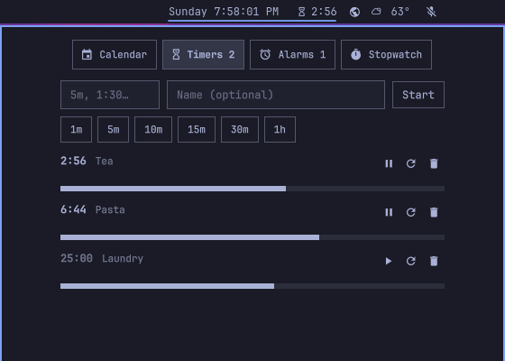

# Clock Plus

Built on Omarchy's own Clock plugin (`omarchy.clock`) and intended as a complete replacement for it. It keeps the bar clock and calendar, and adds timers, alarms, and a stopwatch to the popup.

Forked from `shell/plugins/panels/clock` in [Omarchy](https://github.com/omacom/omarchy) 4.5.0rc2-1. MIT licensed; see `LICENSE`.



## Requirements

- The Omarchy shell (developed against 4.5.0rc2-1)
- `paplay` for the alarm sound. Without it, notifications still appear but there is no sound.
- `wl-paste` (wl-clipboard, included with Omarchy) for pasting into the popup's fields. The fields never let Qt read the clipboard itself, since it reads the whole offer with no size or time limit; a paste reads at most 1 KiB within 2 seconds instead.

## Install

```sh
omarchy plugin add https://github.com/mattwolfgang/omarchy-clock --enable
```

Enabling it takes the built-in clock's place in the bar and keeps your clock settings. Enable only one of the two at a time.

## Remove

```sh
omarchy plugin enable omarchy.clock
omarchy plugin remove io.github.mattwolfgang.clock
```

The first command puts the built-in clock back. Your timers and alarms stay in `~/.local/state/omarchy/io.github.mattwolfgang.clock.json`; delete that file to clear them.

## Using it

Left click the clock and pick a tab. The calendar works as it always has, and the popup stays the same size on every tab.

- **Timers:** type a duration (`5`, `1:30`, `1h 30m`) or press a preset. Finished timers stay listed so you can run them again.
- **Alarms:** type a time (`7:30`, `19:30`, `7pm`) and pick repeat days. No days means once.
- **Stopwatch:** start, pause, lap, reset.

The soonest running timer, or otherwise a running stopwatch, shows beside the time in the bar.

When something finishes, a sound plays for up to a minute and you get a notification. Dismiss or snooze it for five minutes from the notification or from the popup.

Keys in the popup: `1`-`4` pick a tab. Away from the calendar, `h`/`l` also move between tabs. `n` jumps to the entry field on Timers and Alarms. On the Stopwatch, `Space` starts and pauses, `a` records a lap, and `r` resets. `Enter` dismisses whatever is ringing.

## Limits

Everything runs inside the Omarchy shell, so nothing rings while the machine is off or asleep. Anything that fell due up to 15 minutes ago rings when the machine is back; anything older gets a silent "missed" notification. Timers and alarms survive shell restarts, in `~/.local/state/omarchy/io.github.mattwolfgang.clock.json`.

## Development

```sh
node --test tests/   # logic in Time.js
scripts/dev-sync.sh  # copy this checkout into the shell and replace the built-in clock
omarchy-restart-shell   # needed to see QML edits: a plugin rescan can keep cached components
omarchy plugin enable omarchy.clock   # go back to the built-in
```

## Translations

The non-English catalogs in `i18n/` were written by an AI and have not been reviewed by native speakers. Corrections are welcome.
